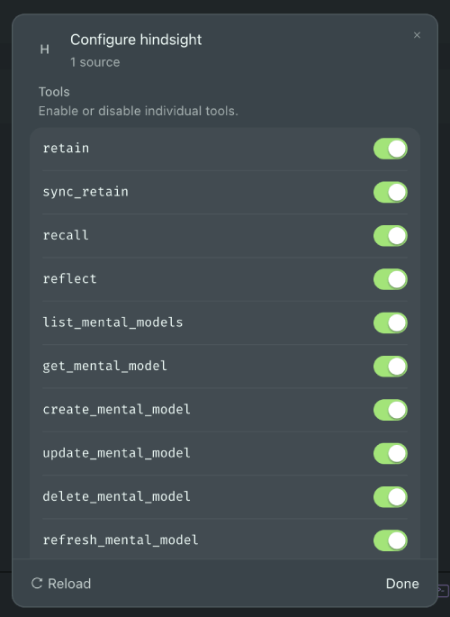

# Nocciolo


**Turn durable project knowledge into agent memory banks**

Nocciolo (Italian for kernel / core): the durable core of project knowledge that agents inherit.

Hindsight is the memory bank.
Nocciolo is the config that turns a repo's durable docs into a bank coding agents can trust.
It decides what from this repo is worth retaining, keeps the link back to the source, and wires the bank into agents without a forced cloud path.
Optionally, `--judge jev` asks whether a section is durable project knowledge before that retain is spent.

## Goal

Seed [Hindsight](https://hindsight.vectorize.io/) memory banks from durable project docs, ADRs, and decisions so agents inherit shared context instead of rediscovering it every session.

[](LICENSE)
[]()

---

## The Problem

AI coding agents start every session cold.

They re-learn architecture decisions, coding standards, domain invariants, and “why we built it this way” from scattered READMEs, ADRs, comments, and tribal knowledge. That wastes tokens, produces inconsistent output, and breaks long-running agentic workflows.

Traditional documentation is written for humans. Agent memory systems need structured, durable, queryable knowledge with clear missions and boundaries.

## The Vision

Nocciolo is the **company brain config** layer.

It turns the durable knowledge already living in your repository into a properly configured memory bank that agents can retain, recall, and reflect against: starting with [Hindsight](https://hindsight.vectorize.io).

Agents inherit shared context instead of rediscovering it.

## What Nocciolo Does

- **Scans** your project for durable knowledge (READMEs, ADRs, standards, domain docs, schemas)
- **Configures** a Hindsight memory bank with a clear mission, directives, and extraction settings tuned for software projects
- **Seeds** the bank with high-signal facts and decisions via Hindsight **retain**: not by uploading raw markdown like a file-sync script
- **Adds an optional Jev judgment layer** so `seed --judge jev` can skip changelogs, tables of contents, and other ephemeral sections before retain. Recall rerank, prune annotation, and routing are still planned: see [Jev](#jev)
- **Emits** the configs and MCP snippets needed to wire the bank into Cursor, Claude Code, Roo, and other agent harnesses
- **Shares** knowledgebases across teams with explicit deployment profiles: local/LAN, VPN, public self-host, or [Hindsight Cloud](https://docs.hindsight.vectorize.io/): so the company brain reaches the agents that need it
- **Stays local-first**: self-host by default; Cloud is opt-in, never required

Hindsight is the first-class target ([retain / recall / reflect](https://hindsight.vectorize.io/), observations, mental models, bank templates).
Host it yourself with Docker or use [Hindsight Cloud](https://docs.hindsight.vectorize.io/) when you want managed infra (same Nocciolo seed/MCP flow: see [docs/hindsight-cloud.md](./docs/hindsight-cloud.md)).
[Graphiti](https://github.com/getzep/graphiti) (and optional Zep Cloud) is planned as an opt-in seed destination, not a second default: see [Graphiti (planned)](#graphiti-planned) below.
Event-driven updates, richer curation, and team-wide sharing are on the [roadmap](./ROADMAP.md).

## Why Nocciolo

Default Hindsight retains whatever you hand it and extracts facts from that text.
The bank is then only as good as whatever landed in retain.
Nocciolo sits in front of that, even when Jev is off.

| Default Hindsight | Nocciolo |
|---|---|
| You decide what to retain | The scanner finds durable sources (README, docs, ADRs) and surfaces candidates |
| Facts come from whatever you send | Heuristics prefer decisions, invariants, and architecture over changelogs, tables of contents, and badge walls |
| Freshness means sending the tree again | Incremental `seed` re-retains only sources whose content hash changed |
| Provenance is whatever you attach | Source path and git commit are first-class on every fact |
| MCP wiring is yours to assemble | `nocciolo mcp` emits configs and rules for Cursor, Claude Code, and other harnesses |
| Bank mission and directives are manual | `init` and `configure` generate a bank template from the project |
| Stale items stay until you clean them | `prune` groups path-gone and section-gone, then tombstones so the same unchanged text does not come back |
| Local Docker is a separate setup | `nocciolo docker` with local-first defaults |

Hindsight remembers what you give it.
Nocciolo decides what from this repo is worth giving it.

The longer developer write-up, including talking points, is [docs/why-nocciolo.md](./docs/why-nocciolo.md).

## Quick Start

### Use from another local project

The CLI is not published yet. From a Nocciolo clone, put `nocciolo` on your PATH, then `cd` into the other repo and run it there (it uses the current working directory):

```bash
# once, in the Nocciolo clone
pnpm install && pnpm build
npm link                               # symlinks `nocciolo` into your Node bin dir

# then, in any other project (e.g. Strumentario)
cd /path/to/your-project
nocciolo --help
nocciolo init                          # scaffold .nocciolo/ (prompts for bank id + Docker container)
nocciolo configure                     # generate Hindsight bank template
nocciolo seed --dry-run                # preview candidates (no API calls)
nocciolo seed                          # retain
nocciolo mcp --write --write-agents --write-cursor-rules --include-auth
```

`pnpm nocciolo …` only works **inside this repo**. Other projects need the linked `nocciolo` binary (or the clone path below). `npm link` needs no extra setup. To link with pnpm instead, run `pnpm setup` once (it creates `PNPM_HOME` and adds it to your PATH), open a new shell, then `pnpm link --global`: without that step pnpm fails with `ERR_PNPM_NO_GLOBAL_BIN_DIR`.

Without linking, invoke the clone’s bin from the other project:

```bash
cd /path/to/your-project
/path/to/nocciolo/bin/nocciolo.js --help
```

Once published to npm:

```bash
npm install -g @nocciolo-ai/cli        # or: npx @nocciolo-ai/cli …
nocciolo init
```

Developing **inside this repo** (no global install required):

```bash
pnpm install && pnpm build             # install deps and build the CLI
pnpm nocciolo init                     # scaffold .nocciolo/ (prompts for bank id + Docker container)
pnpm nocciolo configure                # generate Hindsight bank template
pnpm nocciolo seed --dry-run           # preview candidates (no API calls)
pnpm nocciolo seed                     # retain (no auth)
pnpm nocciolo docker print             # local Hindsight docker command
pnpm nocciolo mcp                      # print MCP snippets
pnpm nocciolo mcp --write --write-agents --write-cursor-rules --include-auth --dry-run
```

Full command and flag reference: [docs/nocciolo-cli-commands.md](./docs/nocciolo-cli-commands.md).

`init` asks for a **bank id** (project-specific) and a **Docker container name** (shared Hindsight server: one container can host many banks). Non-interactive: `--bank-id`, `--container-name`, and `--yes`. Defaults: slug of the project directory for the bank id; container `hindsight`.
When your Hindsight bank requires auth (typical for Docker with `HINDSIGHT_API_TENANT_API_KEY`), pass the **same secret value** into Nocciolo on live `seed` only: `--dry-run`, `init`, and `configure` do not need it:

```bash
# Global install (linked clone or published package)
NOCCIOLO_HINDSIGHT_API_KEY='your-actual-key' nocciolo seed

# Developing this repo without a global install
NOCCIOLO_HINDSIGHT_API_KEY='your-actual-key' pnpm nocciolo seed

# Or export once for the shell session
export NOCCIOLO_HINDSIGHT_API_KEY='your-actual-key'
nocciolo seed

# Or pass the flag
nocciolo seed --api-key 'your-actual-key'

# Optional: read the key from a running Hindsight container (name from init / config; default hindsight)
NOCCIOLO_HINDSIGHT_API_KEY="$(docker exec hindsight printenv HINDSIGHT_API_TENANT_API_KEY)" \
  nocciolo seed
```

Requires Node.js 20+. Point at a custom Hindsight URL with `--hindsight-url`, `NOCCIOLO_HINDSIGHT_URL`, or `hindsightBaseUrl` in `.nocciolo/config.json`. `HINDSIGHT_API_KEY` is accepted as an alias for `NOCCIOLO_HINDSIGHT_API_KEY`.

The goal is a zero-to-useful bank in under five minutes.

## Seeding with `nocciolo seed`

`seed` is the heart of the workflow: curated retain into Hindsight: not a bulk markdown upload. There is **no separate sync command**; when docs change, run `nocciolo seed` again (preview with `--dry-run` first).

### Not a file-sync / upload script

Many Hindsight setups use a script that **uploads markdown files** into the bank as a document corpus: re-processing the whole tree on every run. Nocciolo works differently:

| File-sync / upload scripts | Nocciolo `seed` |
|----------------------------|-----------------|
| Upload raw `.md` files into Hindsight | Extract **high-signal sections** locally (heuristic, conservative) |
| Bank holds a mirror of the doc tree | Bank holds **structured memories** (facts, entities, links) via Hindsight **retain** |
| Re-upload often re-processes everything | **Incremental**: unchanged sources are skipped using content hashes in `.nocciolo/local/seed-manifest.json` |
| Opaque file ids | Stable `document_id`s (`nocciolo:<path>#<section>`) so Hindsight **upserts** instead of duplicating |

**Why retain instead of upload**

- **Agent-native recall**: structured facts, entities, and links for `recall` / `reflect`, not a searchable copy of your `.md` tree
- **Less noise**: conservative extraction skips boilerplate (TOCs, changelogs) and denies secrets before retain
- **Incremental updates**: content hashes skip unchanged sources; only new or edited docs hit Hindsight
- **Stable upserts**: same path + section → same `document_id`; edits update memories instead of duplicating them
- **Provenance**: each fact carries source path, kind, and optional git commit
- **Preview before retain**: `--dry-run` lists candidates with no Hindsight calls. `--judge jev` adds a TypeSafe relevance pass.
- **Clear separation**: bank template (mission/directives) vs seed (project facts); additive, never wipes the bank

Full rationale for contributors: [docs/nocciolo-sync-strategy.md](./docs/nocciolo-sync-strategy.md).

What `seed` actually does:

1. Scan durable sources locally (README, `docs/**`, ADRs: secrets like `.env` excluded). A `scanner` block in `.nocciolo/config.json` replaces that default walk with `include` globs, then applies `exclude` globs. Omit `scanner` to keep the conservative default. The secrets denylist still wins over `include`. `store.allowlist` stays separate: the scanner decides what can be discovered, and the allowlist decides which new files `store` retains.
2. Extract scored candidate facts with provenance (source path + optional git commit). `.mdx` is extracted like markdown when `scanner.extensions` includes `.mdx`. Leading YAML frontmatter is dropped so title and status fields are not retained as sections. Draft filenames are skipped only when an `exclude` glob matches them (for example `**/_*.mdx`).
3. Optionally, with `--judge jev`, ask whether each candidate is durable project knowledge. High-confidence rejects are dropped. Low confidence stays in review. Omit the flag and this step does not run.
4. **Retain** each kept candidate via Hindsight’s memories API (LLM extraction per item)
5. Write incremental state to `.nocciolo/local/seed-manifest.json` (gitignored, machine-local)

Hindsight then runs **consolidation** in the background (observations / mental models). That is expected and usually much faster than re-uploading whole files.

Every `seed` run **reads all durable sources locally** (to compute hashes), but only **new or changed** files are sent to Hindsight unless you pass `--force`. A successful **live** `seed` writes the manifest; `--dry-run` previews only and does not update it: so the first live seed after dry-run only establishes incremental state once retain completes.

**Preview first**

```bash
pnpm nocciolo seed --dry-run
pnpm nocciolo seed --dry-run --judge jev   # optional relevance gate; needs NOCCIOLO_TYPESAFE_API_KEY
```

The first command shows scored candidates from durable docs (README, docs, ADRs), with provenance and skips for empty or low-signal sections.
It does not call Hindsight.
The second command adds the Jev relevance table and calls TypeSafe only.
See [Jev](#jev).

**Retain with clear progress**

```bash
NOCCIOLO_HINDSIGHT_API_KEY='your-key' pnpm nocciolo seed
```

Before retain starts you will see a warning like this: leave the terminal open until Nocciolo finishes:

```text
============================================================
Hindsight is processing retain requests.
Do not close this terminal or press Ctrl+C until Nocciolo reports completion.
Sync mode: 28 item(s); each can take several seconds. Progress shows as percent of items.
Interrupting mid-retain can leave a partial bank; re-run seed (use --force if needed).
============================================================
```

Then progress lines appear as each candidate is retained:

```text
Retaining 28 item(s) synchronously (LLM extraction per item).
Progress:
  [1/28] 0%  starting  nocciolo:README.md#the-problem
  [1/28] 4%  done      nocciolo:README.md#the-problem
  ...
```

A full first seed can take several minutes (LLM extraction per item). That is expected, not a hang.

- Uses stable `document_id`s so Hindsight **upserts** a document’s memories instead of dumping duplicate files into the bank
- Skips secrets and noise (`.env`, credentials, etc.): see [sensitive data](./docs/sensitive-data.md)
- Auth failures stop early (pass `NOCCIOLO_HINDSIGHT_API_KEY` or `--api-key`)

**Re-seed only what changed**

After a successful live seed, re-running `seed` compares each source’s content hash to `.nocciolo/local/seed-manifest.json`. Unchanged files appear under “Skipped N unchanged source(s)” in the plan output and are not retained again. Changed or new files are re-retained with the same `document_id` when the path and section slug match, so Hindsight upserts them. The bank is not wiped.

If incremental skip is not working (everything is retained again), check that `.nocciolo/local/seed-manifest.json` exists on this machine: it is gitignored and is not shared via git. A first live seed, a failed/interrupted seed, or seeding on a fresh clone all behave like a full retain until the manifest is written.

```bash
pnpm nocciolo seed --dry-run          # see what would update vs skip as unchanged
pnpm nocciolo seed                    # incremental retain (only new/changed sources)
pnpm nocciolo seed --force            # re-retain all current candidates
pnpm nocciolo seed --async            # submit + poll Hindsight operation progress
```

Seed is additive.
Use `nocciolo prune` to remove path-gone / section-gone documents, or an explicit `--document-id` / `--source`.
See the [CLI reference](./docs/nocciolo-cli-commands.md#nocciolo-prune).
Optional `--judge jev` scoring for “still on disk but no longer true” is planned later: [Jev integration](./docs/jev-integration.md).

### Day-to-day sequence: retain, then prune

Prefer retaining current truth before deleting leftovers:

1. Edit durable docs (if needed).
2. Run `nocciolo store` (or `seed` for a full bootstrap scan). Preview with `--dry-run` first.
3. Run `nocciolo prune --dry-run`, then prune what is still orphaned.

`store` and `seed` only add or upsert.
They do not remove old `document_id`s.
Pruning after retain means the candidate list is “still stale relative to today’s extract.”
Pruning first can delete an id you were about to bring back on the next retain (for example a restored heading).

If you **edit** a durable file in place, re-run `nocciolo store` or `seed`. That is enough: same path → same `document_id` → upsert.

If you **rename or delete** a source (for example `docs/foo.md` → `docs/bar.md`), retain the new path first, then clean the old ids:

```bash
pnpm nocciolo store --dry-run
pnpm nocciolo store --yes                 # or seed, if you are still bootstrapping
pnpm nocciolo prune --dry-run
pnpm nocciolo prune --document-id 'nocciolo:docs/foo.md#…' --yes
```

`--force` on seed/store does not remove old path ids. Prune deletes the selected documents and writes local tombstones so unchanged text is not re-retained.

Here is the Nocciolo bank’s world-facts constellation in Hindsight after a `seed`: structured memories and links agents can recall, not a dump of raw markdown files:


More detail: [developer workflow](./docs/dev-workflow.md), [sync strategy](./docs/nocciolo-sync-strategy.md).

## Keeping the bank current with `nocciolo store`

`seed` is the initial bootstrap: it scans and retains everything durable it can find. `store` is what you run afterward, for ongoing, operator-selected retain once durable project markdown already exists on disk. It reuses `seed`'s retain path exactly (same `document_id` upserts, same manifest, same auth and progress): it does not reimplement retain, and it never seeds broadly on its own.

`store` never auto-retains chat, diffs, worktrees, or transcripts. It is not transcript ingest, not Backpass, and not Hindsight Coding Agents auto-retain.

### `seed` vs. `store`

| | `seed` | `store` |
|---|---|---|
| When | Once, to bootstrap a brand-new bank | Repeatedly, after the bank already exists |
| Scope | Broad default scan: README, ADRs, `docs/**` | Operator-picked scope only: `store.allowlist` in `.nocciolo/config.json` |
| New files | Adopted automatically | Never adopted implicitly: always previewed or picked, even with `--yes` |
| Retain path | `retainPreparedItems` (shared with `store`) | Same `retainPreparedItems`, same `document_id` upserts, manifest, auth, and progress handling: not a second implementation |

Typical use: run `seed` once per project at the start, then run `store` whenever project docs change.
After retain, run `prune --dry-run` when paths or headings may have gone stale (see [Day-to-day sequence](#day-to-day-sequence-retain-then-prune) above).

```bash
pnpm nocciolo store --dry-run   # known / new / changed / unchanged, with explicit zero counts
pnpm nocciolo store --yes       # store changed known files only; never adopts new files silently
pnpm nocciolo store --files docs/architecture.md   # store exactly these; allowlists them
pnpm nocciolo store --add-files docs/roadmap-notes.md        # allowlist only, no retain
pnpm nocciolo prune --dry-run   # after retain: review path-gone / section-gone leftovers
```

New markdown is never stored implicitly. Preview first: `--dry-run` prints the four buckets and suggested next commands with no API calls. In an interactive terminal (no `--yes`, no `--files`), `store` lets you multi-select which new files to adopt; changed files already on the allowlist are included by default.

The allowlist lives at `store.allowlist` in `.nocciolo/config.json` (version-controlled, alongside `bankId`):

```json
{ "store": { "allowlist": ["README.md", "docs/architecture.md"] } }
```

The first `store` run after a `seed` bootstraps this allowlist from the last seed manifest's sources, so already-seeded files read as known, not new.

`store` refuses to run from a disposable git worktree (a Treehouse pool checkout, for example): it only operates on the durable clone that owns `.nocciolo/`. When run from a worktree it resolves the durable clone via the captain-home registry (`$FM_HOME/.nocciolo/projects.json`, installed by `nocciolo mcp --harness firstmate --write-firstmate`) or via `--project <durable-clone-path>`.

## Local Hindsight & agent wiring

Default path: run Hindsight yourself (Docker). For managed hosting, see [Hindsight Cloud](#hindsight-cloud-opt-in) below and [docs/hindsight-cloud.md](./docs/hindsight-cloud.md).

```bash
pnpm nocciolo docker print             # print docker run (no execute)
pnpm nocciolo docker up                # start local Hindsight (needs Docker + LLM key)
pnpm nocciolo docker status
pnpm nocciolo docker upgrade --to 0.9.2 --dry-run   # pinned image upgrade plan
pnpm nocciolo docker down

pnpm nocciolo mcp                      # print snippets for all harnesses
pnpm nocciolo mcp --write --write-agents --write-cursor-rules --include-auth
```

Pinned Docker upgrades (backup all banks, recreate on the same volume, validate fact counts): [docs/hindsight-upgrade.md](./docs/hindsight-upgrade.md).

After `nocciolo mcp --write ...`, a successful Hindsight MCP connection in Cursor shows your bank with memory tools enabled:



Single-bank MCP URL shape: `http://localhost:8888/mcp/<bankId>/`. LLM key for Docker: `--llm-api-key` or `OPENAI_API_KEY` / `HINDSIGHT_API_LLM_API_KEY`. Tenant auth on the container: `--api-key` (same value as `NOCCIOLO_HINDSIGHT_API_KEY` for seed/MCP).

Hindsight **retain** (what `nocciolo seed` calls) needs a working LLM. If your Hindsight instance is configured for **Ollama**, that process must be running and reachable from the Hindsight container before you seed: otherwise retain returns `500` with errors like `ConnectError: All connection attempts failed` / `Fact extraction failed`. Start Ollama (`ollama serve`), ensure the model is pulled, and use a base URL the container can reach (often `host.docker.internal`, not `localhost`). Cloud providers (e.g. OpenAI via `HINDSIGHT_API_LLM_API_KEY`) do not need Ollama.

### Hindsight MCP tools (any agent)

After you wire the project bank MCP endpoint (`http://localhost:8888/mcp/<bankId>/`), Cursor, Claude Code, Roo, Codex, Kiro, Firstmate, and other harnesses that speak MCP expose the same Hindsight tools for that bank. `--harness firstmate` prints a captain-home snippet only (see [docs/nocciolo-cli-commands.md](./docs/nocciolo-cli-commands.md)); it does not write into this repo.

The three you will use most often:

| Tool | Use it to |
|------|-----------|
| `recall` | Query the project memory bank for durable knowledge (architecture, decisions, standards, domain rules) |
| `reflect` | Pull insights and mental models from the bank (synthesis against observations) |
| `retain` | Add new memories (prefer `nocciolo seed` for doc-backed facts; use MCP `retain` sparingly for ad hoc notes) |

Typical prompts once MCP is connected:

- “Recall our architecture boundaries / coding standards / how we treat secrets.”
- “Reflect on how seeding and bank configuration should stay separated.”

Prefer `recall` / `reflect` before rediscovering the same facts from scattered docs.
Treat repo docs and ADRs as source of truth; the bank is the agent-facing memory of those sources.
Do not retain secrets, credentials, or ephemeral chat into the bank.

For curated playbook answers (architecture, standards, how we work), declare and refresh Hindsight mental models.
See [docs/mental-models.md](./docs/mental-models.md).

Wire any harness with `nocciolo mcp` (print snippets, or `--write` / `--write-agents` / `--write-cursor-rules`).
Full CLI flag list: [docs/nocciolo-cli-commands.md](./docs/nocciolo-cli-commands.md).

### Claude Code

Claude Code does not read `.cursor/mcp.json`.
Use the Claude Code snippet from `nocciolo mcp` (or run the printed `claude mcp add` command).

```bash
# Print only the Claude Code snippet (single-bank MCP URL for this project)
pnpm nocciolo mcp --harness claude-code

# If your Hindsight tenant requires auth, include the Authorization header
pnpm nocciolo mcp --harness claude-code --include-auth
```

Typical output (bank id and URL follow your `.nocciolo/config.json`):

```bash
claude mcp add --transport http hindsight http://localhost:8888/mcp/nocciolo/
```

With auth (`--include-auth`), the command also passes a Bearer header that references `NOCCIOLO_HINDSIGHT_API_KEY` (export that env var in the shell where Claude Code runs).

**Before you trust `docker status`**

`nocciolo docker status` looks for the container name in `.nocciolo/config.json` (`docker.containerName`, default `hindsight`).
If Hindsight is already running under a different name (for example a shared `suchconfig-hindsight` server), status may say the container was not found even though the UI at `http://localhost:9999` and the API at `http://localhost:8888` work.
Check with `docker ps | grep -i hindsight`, then either:

```bash
pnpm nocciolo docker status --name your-actual-container-name
```

or update `docker.containerName` in `.nocciolo/config.json` to match the running container.
Do not run `nocciolo docker up` if ports `8888` / `9999` are already bound.

**Finish the Claude Code wiring**

1. Run the printed `claude mcp add …` command from the project directory (project scope).
2. Confirm the MCP URL responds (HTTP 200 on `http://localhost:8888/mcp/<bankId>/`).
   A raw `curl` may show `Missing session ID`; that is expected without an MCP handshake.
   Claude Code performs the session handshake itself.
3. Exit and restart the Claude Code session so the new MCP server loads.
4. Prefer the bank with `--write-agents` (or keep the AGENTS.md bank section) so the agent recalls before rediscovering docs.

Once connected, Claude Code uses the same Hindsight MCP tools as other agents (`recall`, `reflect`, `retain`).
See [Hindsight MCP tools (any agent)](#hindsight-mcp-tools-any-agent) above.
Ask Claude Code to recall project context after restart; it should call those tools when the server is configured.

### Hindsight Cloud (opt-in)

Skip local Docker and point Nocciolo at [Hindsight Cloud](https://docs.hindsight.vectorize.io/): same `configure` / `seed` / `mcp` commands, managed API at `https://api.hindsight.vectorize.io`. Create an org and API key in the [Cloud console](https://ui.hindsight.vectorize.io); free credits and a short course are on [Hindsight Academy](https://learn.hindsight.vectorize.io/).

```bash
export NOCCIOLO_HINDSIGHT_URL=https://api.hindsight.vectorize.io
export NOCCIOLO_HINDSIGHT_API_KEY=hsk_…   # from Cloud → Connect → Create API Key

nocciolo seed --dry-run
nocciolo seed
nocciolo mcp --hindsight-url https://api.hindsight.vectorize.io --include-auth --write
```

Interactive IDEs can also use Cloud’s OAuth MCP host (`https://mcp.hindsight.vectorize.io`) instead of pasting a key: details and trade-offs in [docs/hindsight-cloud.md](./docs/hindsight-cloud.md). Choose Cloud with `nocciolo share --profile hindsight-cloud` (API key required; Docker skipped).

### Graphiti (planned)

Hindsight stays the default.
A later [Graphiti](https://github.com/getzep/graphiti) / Zep adapter will reuse the same scan → curate → seed → MCP emit path behind `--provider graphiti` (Zep Cloud via `--provider zep`).

Nocciolo will seed a project graph from durable docs (ADRs, standards, architecture), install a software ontology, and point `mcp` / `docker print` at the official Graphiti stack.
It will not install or run Graphiti for you.

Full design: [docs/graphiti-integration.md](./docs/graphiti-integration.md). Tracked under Phase 8 in the [roadmap](./ROADMAP.md).

### Jev

Jev ([TypeSafe System One](https://docs.typesafe.ai/introduction)) is an optional judge, not a memory backend or CLI provider.
Hindsight remains the bank.
Offline heuristics remain the path when `--judge jev` is omitted.
You bring your own TypeSafe key (`NOCCIOLO_TYPESAFE_API_KEY`).
Without that key, behavior is unchanged and Nocciolo makes no TypeSafe call.

Hindsight can optionally rerank recall with Jev.
That orders memories already in the bank.
Nocciolo's Jev layer is the gate in front of retain: it decides which section is worth storing.

| What still gets through heuristics | What `seed --judge jev` does |
|---|---|
| Changelogs, tables of contents, generated dumps, and meeting notes | Asks `is_durable`, `is_ephemeral`, `in_scope`, a durability score (0 ephemeral through 4 constitutional), and a knowledge `kind` on the section |
| A README that mixes an architecture decision with badges | One file can produce a mix of retain, skip, and review rows (`nocciolo:<path>#<section>`) |

```text
nocciolo seed --dry-run --judge jev
  document_id, path, heading, decision, score, confidence, kind, probabilities, heuristic-vs-jev
  high-confidence rejects are skipped, including confident noise and style_pref
  low-confidence rows stay in review and are not retained
  retained rows get stable knowledge:<kind> tags
  Hindsight retain runs only for the rows the gate keeps
```

A confident reject is ephemeral and not durable, or out of scope for the bank mission.
`--confidence` defaults to 0.8.
A noul between that threshold and `1 - confidence` stays in the review queue.
Jev returns the typed answers.
Nocciolo policy decides retain, skip, or review.
Jev does not write the bank or the repo.
Secrets and denylisted paths stay on the machine.

A typical section call is on the order of 1,000 to 2,500 input tokens.
TypeSafe bills input tokens only, about $0.042 per million, and output is free.
A first seed of a normal docs tree is cents.
Later runs judge changed sections, not the whole bank on every command.

Product rule: [docs/jev.md](./docs/jev.md).
Where it sits: [docs/jev-integration.md](./docs/jev-integration.md).
Developer talking points: [docs/why-nocciolo.md](./docs/why-nocciolo.md).
Tracked under Phase 7 in the [roadmap](./ROADMAP.md).

`nocciolo prune` (path-gone / section-gone / explicit) is in the CLI today: [CLI reference](./docs/nocciolo-cli-commands.md#nocciolo-prune).
Optional `--judge jev` annotation on prune is not shipped yet.

Still planned, tracked in [JEV-0](https://github.com/zanuka/nocciolo/issues/58) and the [open `jev` issues](https://github.com/zanuka/nocciolo/issues?q=is%3Aissue+is%3Aopen+label%3Ajev):

- `store` and seed-priority decisions, including a retain budget.
- Optional `--judge jev` on `nocciolo prune`: annotate outdated, irrelevant, or contradicted items, including when the file is still on disk. You confirm, then Nocciolo deletes. Flags: [CLI reference](./docs/nocciolo-cli-commands.md#nocciolo-prune).
- MCP recall guards, so an agent `retain` of session notes can be refused.
- A golden set that can improve the offline heuristics without requiring Jev at runtime.
- Deployment-profile and share-safety checks, with Firstmate routing and escalation when confidence is low.

### `nocciolo mcp` options

By default `mcp` **prints** ready-to-paste configs. It does not detect your IDE: use write flags for the files you want.

| Flag | What it does |
|------|----------------|
| *(none)* | Print snippets for Cursor, Claude Code, Claude Desktop, Roo, Codex, and Kiro |
| `--harness <list>` | Limit output: `cursor`, `claude-code`, `claude-desktop`, `roo`, `codex`, `kiro`, `firstmate`, or `all` (comma-separated) |
| `--write` | Write/merge project `.cursor/mcp.json` |
| `--write-roo` | Write/merge project `.roo/mcp.json` (`type: streamable-http`) |
| `--write-kiro` | Write/merge project `.kiro/settings/mcp.json` |
| `--write-agents` | Upsert an `AGENTS.md` section telling agents to prefer the project bank |
| `--write-cursor-rules` | Write `.cursor/rules/hindsight-bank.mdc` (`alwaysApply: true`) |
| `--write-firstmate` | Install the `project-bank` skill and record this project's bank in the captain-home registry (`$FM_HOME/.nocciolo/projects.json`, fallback `~/.nocciolo/projects.json`); prints install steps instead of writing when `$FM_HOME` is unset. Never writes MCP config into this product repo. |
| `--dry-run` | Preview writes without touching the filesystem (requires at least one `--write*` flag) |
| `--force` | Overwrite an existing `hindsight` MCP entry, Cursor rule file, or `project-bank` skill |
| `--hindsight-url <url>` | Override Hindsight base URL for the MCP endpoint |
| `--include-auth` | Add `Authorization` headers; written files use env placeholders (`${env:NOCCIOLO_HINDSIGHT_API_KEY}` for Cursor) |
| `--api-key <key>` | Include this key **literally** in printed snippets only; file writes still use env placeholders |

Examples:

```bash
pnpm nocciolo mcp --harness cursor,claude-code
pnpm nocciolo mcp --harness claude-code --include-auth   # print `claude mcp add` (+ auth header)
pnpm nocciolo mcp --write --dry-run
pnpm nocciolo mcp --write --include-auth
pnpm nocciolo mcp --write-roo --write-kiro --dry-run
pnpm nocciolo mcp --write --write-agents --write-cursor-rules --force
pnpm nocciolo mcp --hindsight-url http://127.0.0.1:8888 --include-auth
```

## Docs

- [CLI commands](./docs/nocciolo-cli-commands.md): full `nocciolo` command and flag reference (`init`, `configure`, `seed`, `store`, `mental-model`, `prune`, `mcp`, `docker`)
- [Why Nocciolo](./docs/why-nocciolo.md): what the CLI adds over default Hindsight, and what `--judge jev` adds on top
- [Jev product rule](./docs/jev.md): Jev is a judge, not a backend (opt-in, do-not-build, confidence gate)
- [Jev diagrams](./docs/jev-diagrams.md): how Jev enhances store of new data and updates to changed content
- [Jev integration](./docs/jev-integration.md): opt-in judge. The seed relevance gate is available. Prune annotation is still planned.
- [Sync strategy](./docs/nocciolo-sync-strategy.md): why Nocciolo uses curated retain instead of markdown file upload
- [Knowledge-base configs](./docs/nocciolo-configs.md): `.nocciolo/` files, bank template, seed manifest, and MCP recall
- [Team sharing](./docs/team-sharing.md): deployment profiles, `nocciolo share`, bank apply, multi-repo MCP for teams
- [CLI architecture](./docs/cli-architecture.md): module boundaries, seed pipeline, config, and env/auth for contributors
- [Developer workflow](./docs/dev-workflow.md): build, first seed, re-seed, and Hindsight retain/consolidation tips
- [Developer testing](./docs/dev-testing.md): end-user command sequence and E2E regression checklist
- [Hindsight Cloud](./docs/hindsight-cloud.md): opt-in managed hosting vs local Docker; profiles, auth, MCP
- [Graphiti integration](./docs/graphiti-integration.md): planned opt-in Graphiti / Zep seed provider (not the CLI default)
- [Hindsight bank backup](./docs/hindsight-bank-backup.md): Docker `hindsight-admin` full backup and per-bank export
- [Hindsight upgrade](./docs/hindsight-upgrade.md): `nocciolo docker upgrade --to <version>` (manual Docker fallback)
- [Mental models](./docs/mental-models.md): user guide for configure → apply → seed → refresh → agent reflect
- [Hindsight mental models (design)](./docs/hindsight-mental-models.md): tagging, wizard internals, provider boundaries
- [Phase 4 dogfood gaps](./docs/phase-4-dogfood-gaps.md): Strumentario lessons: multi-repo MCP, template apply, shareable config
- [Phase 5 dogfood gaps](./docs/phase-5-dogfood-gaps.md): zanuka-web lessons: `store` ops path; prune shipped; optional bank-list helper / dogfood archive of Python seeder
- [Phase 6 dogfood gaps](./docs/phase-6-dogfood-gaps.md): nocciolo bank pass: apply → refresh → reflect on Hindsight 0.10.3
- [Sensitive data](./docs/sensitive-data.md): allowlist/denylist decisions so secrets never get retained

## Core Principles

- **Durable over ephemeral**: only knowledge that should outlive a single session or model change
- **Local control**: self-hostable by default; [Hindsight Cloud](https://docs.hindsight.vectorize.io/) is opt-in, never required
- **Agent-native**: missions, directives, and structure that map cleanly to how modern memory systems actually work
- **Traditional craft first**: clear architecture, ADRs, and standards remain the source of truth; Nocciolo amplifies them for agents
- **Progressive**: start simple (single bank, one project), grow into multi-bank, multi-repo, team sharing, and event-driven workflows
- **Share on your terms**: local/LAN, VPN, public self-host, or Hindsight Cloud when managed hosting fits the team

## Status

Nocciolo is in the earliest public stage. We are building in the open.

See [ROADMAP.md](./ROADMAP.md) for the high-level phased plan.

## Contributing

Issues, ideas, and PRs are welcome once the foundation lands. For now the best way to help is feedback on the vision and the initial CLI surface.

## Author

Created by [zanuka](https://github.com/zanuka) (Mike Delucchi)

## License

Copyright © 2026 Mike Delucchi. Released under the [MIT License](LICENSE).

