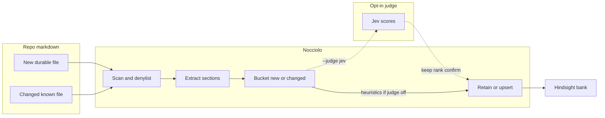
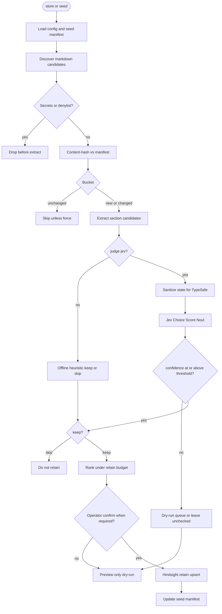
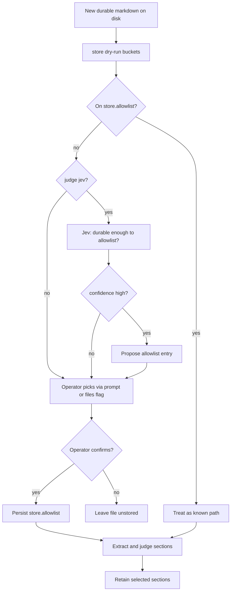
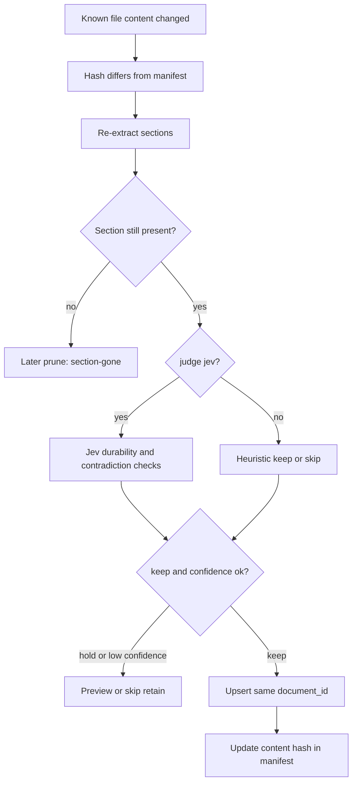
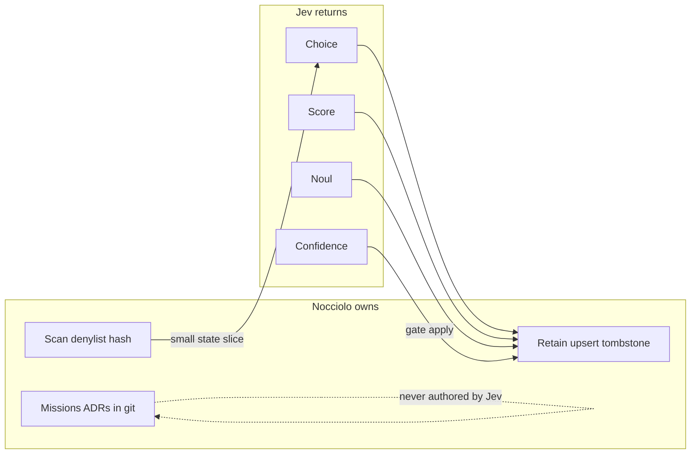

# Jev diagrams: store and update paths

How the opt-in Jev judge sits on Nocciolo's retain path when you store **new** durable markdown or update **changed** content already in the bank.

Product rule: [jev.md](./jev.md).
Narrative design: [jev-integration.md](./jev-integration.md).
Judge port: `src/judge/` ([JEV-2](https://github.com/zanuka/nocciolo/issues/21)).
Section keep/skip and `store` durability gates are planned ([JEV-4](https://github.com/zanuka/nocciolo/issues/30) onward); the diagrams show the intended operator experience with `--judge jev`.

Without `--judge jev`, solid boxes still run. Dotted Jev steps are skipped and offline heuristics decide keep/skip.

---

## New vs changed at a glance

`seed` and `store` share one retain path (stable `document_id` upserts, seed manifest under `.nocciolo/local/`).
Buckets differ by how the operator selects files:

| Bucket | Meaning | Typical command |
|--------|---------|-----------------|
| New | Durable `.md` not yet on `store.allowlist` / not in the seed manifest | `store` preview, then confirm or `--files` |
| Changed | Same source path, content hash differs from the last retain | `store` / `seed` re-retain (upsert) |
| Unchanged | Hash matches; skip unless `--force` | no Hindsight call |

Jev does not invent new files or rewrite docs.
It scores candidates Nocciolo already extracted, then Nocciolo retains only after confidence and (when required) confirmation.

---

## Store / seed retain with Jev

Operator flow for `nocciolo store` (or `seed`) when Jev is enabled.
Nocciolo owns every side effect: denylist, hash, upsert, manifest.

Notes:

- Default `--confidence` is `0.8` ([jev.md](./jev.md)).
- Missing `NOCCIOLO_TYPESAFE_API_KEY` with `--judge jev` is a hard error.
- Network / 429 / 5xx: warn once and fall back to heuristics unless `--strict`.

---

## New file adoption (`store`)

When a durable file appears that is not on the allowlist yet, Jev can propose adoption.
The operator still confirms. `store` never silently adopts new files.

---

## Changed content update

When a known source's hash changes, Nocciolo re-extracts and upserts by `document_id`.
Jev can hold an edit that does not look durable (changelog noise, temporary notes) even though the path is already allowlisted.

---

## Job split reminder

---

## Related

- [jev.md](./jev.md): product rule (judge, not backend)
- [jev-integration.md](./jev-integration.md): where Jev sits on the full pipeline
- [nocciolo-cli-commands.md](./nocciolo-cli-commands.md): `seed` / `store` flags including `--judge`
- [nocciolo-sync-strategy.md](./nocciolo-sync-strategy.md): why curated retain beats file upload
